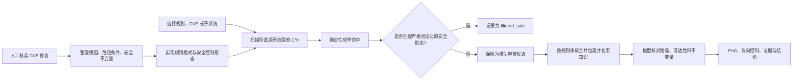

# Linux 内核 CVE 规则知识库如何工作

本文说明 `kernel-vuln` 的 CVE 规则模式如何从已知漏洞修复整理知识、如何在 Linux 源码中枚举候选，以及模型和运行验证如何接手。它描述的是仓库当前实现，不把规则命中等同于漏洞结论。

## 一句话概括

人工先从已核实的 CVE 修复补丁中总结“危险条件是什么、修复建立了什么安全不变量”；扫描器再在对应源码范围中用确定性的 C 词法模式枚举相似位置；只有能识别为已核实安全形态的命中才会被自动过滤；剩余命中按同一根因规则合并成审查包，模型复用该规则已经核实的追踪、控制样例和检查清单；若模型认为存在新的可达条件，仍须完成 PoC、负向控制和证据记录。



## 知识库存在哪里

仓库里有两种相关记录，作用不同：

| 记录 | 用途 | 是否直接驱动运行时扫描 |
| --- | --- | --- |
| [`KERNEL_CVE_KNOWLEDGE.json`](../KERNEL_CVE_KNOWLEDGE.json) | CVE/CWE 索引、严重性来源、根因、触发条件、修复不变量、补丁出处、规则状态、样例和验证台账 | 否。它是供人查阅和审计的结构化台账 |
| Rust 规则实现 | 活动规则的作用范围、词法匹配方式、安全过滤方式，以及传给模型的已核实知识 | 是。命令运行时从编译进程序的规则表中选择规则 |

因此，只在 JSON 中增加一条 CVE 记录不会让扫描器自动启用它。要让 CVE 真正成为活动规则，需要在 Rust 规则目录中定义规则、实现候选匹配模式和适用的严格安全过滤器，整理模型复用的知识记录，并用修复前签名与修复后控制形态验证，再将验证状态登记回 JSON。代码入口见 [`kernel_vuln_rules.rs`](../codex-rs/cli/src/kernel_vuln_rules.rs)、[`kernel_vuln_rule_catalog.rs`](../codex-rs/cli/src/kernel_vuln_rule_catalog.rs)、[`kernel_vuln_c_rule_patterns.rs`](../codex-rs/cli/src/kernel_vuln_c_rule_patterns.rs)、[`kernel_vuln_c_filters.rs`](../codex-rs/cli/src/kernel_vuln_c_filters.rs) 和 [`kernel_vuln_rule_knowledge.rs`](../codex-rs/cli/src/kernel_vuln_rule_knowledge.rs)。

目前运行时有 20 条活动规则：最初的规则定义在 `kernel_vuln_rules.rs`，另外 17 条在 `kernel_vuln_rule_catalog.rs`。每条规则对应一个经人工审查的 CVE 根因案例；同一个 CWE 下的规则可以共享分类，但不会因此自动共享同一个检测器。CWE 主要用于归档和理解根因类别，候选是否命中由每条规则自己的源码模式决定。

## 一条规则保存什么

运行时规则的主要字段包括：

- **身份与分类**：规则 ID、标题、来源 CVE、人工选择的主 CWE。
- **扫描范围**：子系统目录，例如 `net/sched`。原修复文件和函数记录修复出处，但通常只是来源信息，不会把扫描限制在原函数。
- **根因描述**：漏洞条件、可复用的危险代码形态、必须满足的安全不变量，以及模型审查合同。
- **来源证据**：修复提交、修复链接和公告链接。
- **确定性实现**：候选匹配模式和对应的安全过滤器。
- **可复用审查知识**：核实所依据的源码 revision、已核实事实、已知安全控制、未决假设和重点检查项。

JSON 台账还保存 CVE 年份、受影响组件、报告中的 CWE 映射、CVSS 评分及来源、人工整理的根因/触发条件/修复不变量、规则激活状态，以及 fixture 和全树扫描验证记录。台账把 CVE 原记录的 CWE 与补丁根因整理出的主 CWE 分开保存；两者可能不同。

规则知识按证据状态区分：

- **已核实事实**可以在目标源码 revision、保护条件和数据路径未变化时复用。
- **已知安全情况**用作负向控制或过滤依据，不是漏洞触发条件。
- **未决假设**必须继续验证，不能因为写入知识库就变成已确认发现。
- **重点检查项**告诉模型需要检查的边界，例如输入来源、别名、检查是否先于使用、生命周期和并发路径。

## 从命令到源码命中

### 1. 选择模式和规则

规则模式默认关闭。传入 `--use-cve-rules` 后启用规则扫描；传入一个或多个 `--cve-rule CVE-ID` 也会自动启用规则模式，并将规则限定到指定 CVE。未知或尚未成为活动规则的 CVE 会报错。

`--focus` 按规则登记的源码范围筛选规则。例如 `--focus net/sched` 只选择该范围内的活动规则；`--cve-rule` 与 `--focus` 同用时，两者必须匹配。CVE 参数可以重复传入，用于挑选多个活动规则。

### 2. 枚举源码位置

选定规则后，扫描器递归收集其范围内的 `.c` 和 `.h` 文件，合并并去重文件列表，然后对每个文件：

1. 读取源码并用仓库内的有限范围 C lexer 切分词法单元。
2. 忽略注释和字符串/字符字面量，识别简单的顶层函数定义并抽取函数体。
3. 对每个函数体应用所选规则的确定性词法模式。

这些模式是规则专用的结构检查，例如在同一个函数中识别磁盘长度字段及其后续使用、识别长度乘 `HZ` 后送入计时器的赋值、识别对象引用和释放相关调用。它们并不依赖模型临时猜测候选位置。原 CVE 的函数名和文件名用于解释修复出处；除非某个模式本身要求特定语法形态，扫描器会在所选范围内查其他函数中的相似结构。

匹配结果只说明函数体中存在规则所描述的词法线索。报告中的行号来自函数定义位置，供定位函数使用；它不一定是具体匹配 token 所在行。

### 3. 有限解析能力及其覆盖边界

当前解析器不是完整 C 编译器、AST 或通用数据流分析器。它不展开宏、不评估 Kconfig 条件，也不普遍追踪跨函数数据流、复杂别名或所有预处理器语法。无法读取或解析的文件会列为扫描覆盖缺口；解析失败不会被当作安全代码。某条规则没有命中，只表示在成功解析的文件中没有匹配到当前编码的模式，并不能证明该子系统安全。

词法模式也会有漏报风险：字段重命名、宏封装、不同但语义相同的实现、跨函数传递，以及未覆盖的控制流都可能避开模式。它的目标是稳定地缩小人工/model 审查范围，不是证明规则覆盖了 Linux 中所有同类漏洞。

## 安全过滤、分组和审查预算

每一个词法命中会经过该规则的安全过滤器。过滤器只对编码并验证过的窄安全形态给出 `filtered_safe`，例如已核实补丁中的长度检查确实在使用前拒绝越界输入，或整数范围检查确实支配每一处乘法转换。过滤器认不出、路径复杂、别名不明、条件编译不确定或检查不支配使用时，命中会保留下来交给模型。

安全过滤不是通用语义证明。过滤器会记录可识别控制的理由；规则样例回放和人工复核用来检查这些模式。无法确定安全时应保留候选，而不是推测安全。

过滤后，同一个 `rule_id` 下保留的多个源码位置会合并为一个规则家族审查包。例如一个共享验证函数的多个消费者，不会仅因为位置不同就被拆成多个独立候选。候选按匹配强度排序，再按路径、行号、函数和规则 ID 稳定排序；随后 `--count` 限制本轮最多启动多少个规则家族审查。它限制审查包数，不是命中数，也不保证每条规则都会被审查。没有保留候选时会生成扫描报告，不启动模型。

例如，只审查 `net/sched` 范围：

```sh
codex kernel-vuln \
  --use-cve-rules \
  --focus net/sched \
  --linux-path /root/workspace/linux \
  --output-dir /root/workspace/linux-vuln-net-sched \
  --count 1
```

只选择特定 CVE 时：

```sh
codex kernel-vuln \
  --cve-rule CVE-2025-38193 \
  --linux-path /root/workspace/linux \
  --output-dir /root/workspace/linux-vuln-cve-2025-38193 \
  --count 1
```

## 模型如何复用知识并检查候选

每个审查包的提示词只包含该规则及其命中位置，而不是重复注入整个 CVE 库。提示词包括根因条件、危险模式、安全不变量、修复出处，以及该规则的已核实事实、已知安全情况、未决假设和重点检查项。

模型先记录当前源码 revision 和工作区状态。若知识核实所依据的 revision 不同，它需要重新确认规则所依赖的保护条件和数据路径。若 revision、保护条件和路径保持不变，模型应复用已有追踪和控制结果；若路径变化或候选绕过保护，则只追踪变化或绕过部分。重复位置会放在同一审查包内比较，不应机械地各自生成一份发现。

规则模式是有界审查：它只让模型处理扫描器留下的规则候选，不要求该轮再做开放式子系统搜索。模型仍要判断输入是否可控、路径是否可达、安全不变量是否被破坏、影响是否成立以及是否与已有发现重复。规则的 CVE 只是可复用成因的来源，原 CVE 本身不能作为新漏洞报告。

## 从候选到结论：PoC 和证据

模型确认有独立且可达的安全条件破坏后，内置研究合同要求针对同一根因构建一个用户态 PoC，从干净设置重复运行两次，并执行一个接近触发边界的负向控制。触发潜在内核问题的实验应放在带快照的隔离虚拟机中，使用树外内核构建；不能在宿主内核上试触发，也不能修改提供的 Linux 源码树。若没有合适的隔离目标，运行结果应标为未决，而不是把静态命中写成已验证漏洞。

报告需要记录精确源码 revision、源代码引用、触发条件、实验命令和原始输出、负向控制、影响与限制。结论首行用 `confirmed`、`plausible`、`negative`、`inconclusive` 或 `duplicate` 表示状态。`plausible` 是有证据支持但尚未完成确认的候选，不能等同于已确认 CVE。

## 输出文件与可审计性

规则模式会在输出目录生成 `rule-scan-<UTC 时间>.md`，其中记录：源码快照、规则和扫描范围、C/H 文件数、各位置的命中/过滤状态、没有命中的规则、解析缺口、分组和受 `--count` 限制而未排期的审查包。实际发给模型的完整提示词保存在相应的 `candidates/candidate-NNN/prompt.md`；模型日志、运行指标、候选报告和 PoC 等也保存在候选目录。`PROCESS_LOG.md` 记录编排过程，`FINDING_INDEX.md` 用于排除已有根因重复项。

这些文件让人能分别检查“规则扫到了哪里”“为什么过滤或保留”“模型收到什么知识”“最终实验支持什么结论”，而不是只看模型最后一句话。

## 与开放搜索和自定义提示词的区别

| 方式 | 候选位置如何产生 | 是否有结构化规则知识 | 主要工作方式 |
| --- | --- | --- | --- |
| 开放搜索（不加 `--use-cve-rules`，也不传 `--cve-rule`） | 模型自行探索 | 没有自动加载某个 CVE 规则组 | 每个 `--count` pass 进行开放式搜索 |
| 自定义提示词（`--extra-prompt` 或 `--extra-prompt-file`） | 仍由原模式决定 | 可以把文字知识附加到提示词 | 增加说明，但不会单独启用确定性源码枚举、规则分组或安全过滤 |
| CVE 规则模式 | 扫描器确定性枚举后保留的源码位置 | 加载对应规则家族的结构化知识 | 有界审查候选；按规则家族去重并复用追踪和控制 |

自定义提示词也可以与规则模式一起使用，但会附加在内置研究合同之后，不能取消 PoC、控制实验、只读源码和证据要求。做 prompt-only 对照时，不应开启 `--use-cve-rules` 或传入 `--cve-rule`。

## 当前知识库的验证状态与限制

截至 [`KERNEL_CVE_KNOWLEDGE.json`](../KERNEL_CVE_KNOWLEDGE.json) 中记录的验证快照，20 条规则都已激活。新增的 17 条规则有修复前签名 fixture 命中和修复后控制形态检查；这些 fixture 用于验证编码的匹配器及窄过滤器，不等于对每个历史内核版本做了完整源码回放，也不测量 Linux 全树召回率。

该台账记录的一次 Linux 全树 dry-run 扫描使用源码 revision `fe2ec83746e501645709761605c2464a44fd2929`：扫描 2,791 个 C/H 文件、成功解析 2,786 个，报告 5 个解析缺口；共枚举 21 个位置，9 个被严格安全形态过滤，12 个保留并合并为 3 个规则家族，10 条规则在本次已解析源码中无命中。这些数字描述的是那次扫描结果，不是规则精确率、召回率或新漏洞数量。

知识库还保留着未确认结论。例如，CVE-2025-38193 派生的 `net/sched` 近似路径有资源影响线索，但记录状态仍是 `plausible`；其他候选也可能只是需要人工排除的安全实现。新规则是否有用，最终要看后续审查是否减少了重复工作、是否保留了重要候选、过滤是否安全，以及真实 PoC 和控制实验能否支持结论。

## 具体例子：CVE-2023-52640（NTFS3 EA 名称长度）

这个例子展示一条已知修复如何变成规则，并如何区分“修复前危险形态”和“修复后的安全控制形态”。它验证的是规则流程；已知 CVE 本身不是新的发现。

### 1. 从补丁提炼根因和不变量

CVE-2023-52640 位于 `fs/ntfs3`，原修复位置是 `fs/ntfs3/xattr.c` 的 `ntfs_list_ea`，知识库将其按修复根因归到主 CWE-125（越界读）。JSON 台账记录的核心条件是：NTFS 磁盘上的扩展属性（EA）条目提供 `name_len`；若它超过同一 EA 条目的实际范围，`ntfs_list_ea` 可能在读取名称或更新输出长度时越过该条目边界。触发路径是挂载构造的 NTFS 镜像并枚举这样的 EA。

补丁提炼出的不变量是：**在读取/复制 EA 名称或累加输出长度之前，必须确认该条目的 `name_len` 不超过同一个条目解码出的 `ea_size`。** 不能用另一个 EA 条目的长度、普通字符串长度上限，或发生在读取之后的检查代替这个验证。

简化的修复前形态如下：

```c
ea_size = unpacked_ea_size(ea);
if (buffer)
    memcpy(buffer + ret, ea->name, ea->name_len);
ret += ea->name_len + 1;
```

规则希望找到的是同一函数里“解码条目范围、取磁盘提供的名称长度、把名称读出或计入输出长度”的组合。单独出现 `memcpy`、`name_len` 或 `unpacked_ea_size()` 都不足以得出安全结论。

### 2. 把经验写入规则和知识记录

活动规则 ID 为 `ntfs3-ea-name-length`，作用范围是 `fs/ntfs3`。规则保存 CVE/CWE、根因描述、危险模式、安全不变量、验证合同和补丁链接。配套知识记录还保存核实 revision、已核实事实、已知安全形态、未决假设和重点检查项。

此规则的重点检查项要求模型追踪：`name_len` 是否确实来自当前磁盘 EA；`ea_size` 是否由同一个 `ea` 解码；检查是否发生在所有名称读取和大小累加之前；别名是否被改写；循环是否可能通过 `goto` 或其他出口绕过检查。核实记录表明，修复后的保护会在名称复制和输出长度更新之前退出循环。这个已知修复用来指导审查和构成控制，不表示任意长字段相似代码都安全。

### 3. 确定性扫描如何找候选

执行下面的命令时，规则模式只选择 CVE-2023-52640 派生规则：

```sh
codex kernel-vuln \
  --cve-rule CVE-2023-52640 \
  --linux-path /root/workspace/linux \
  --output-dir /root/workspace/linux-vuln-cve-2023-52640 \
  --count 1
```

这条命令演示如何选择规则。若目标树已包含修复，而且没有其他未被安全过滤的命中，工具会只生成扫描报告，不会为了凑满 `--count 1` 而启动模型。

扫描器递归读取 `fs/ntfs3` 下的 C 和头文件，抽取可识别的函数体，再对每个函数运行 `EaNameLength` 词法模式。这个模式先要求在同一函数中出现 `unpacked_ea_size(某个变量)`，然后检查该变量是否有 `name_len` 和 `name` 成员访问，并且函数中还出现名称复制调用或 `ret` 的 `+=` 长度更新。历史函数名 `ntfs_list_ea` 用来标识修复来源，不会把搜索锁定在该函数；同一子系统里改名后的相似函数也有机会命中。

这只是有意偏宽的候选枚举条件。匹配表示“需要检查这个函数中的 EA 长度关系”，不是“已发现越界读”。报告会记录规则 ID、文件、函数、函数定义行号、匹配强度和命中理由；行号定位到函数定义，不保证就是具体危险表达式的那一行。

### 4. 为什么某些命中被过滤，另一些保留

这条规则的安全过滤器只识别经过核实的特定结构：`ea_size` 由当前循环里的 `unpacked_ea_size(ea)` 得到；对当前 `ea->name_len`（或绑定后未被改写的局部 `name_len`）进行 `> ea_size` 检查；检查位于循环体的直接层级、在名称复制和输出大小累加之前；越界分支退出当前循环迭代；相关值在检查与使用间没有被改写，也没有已识别的 `goto` 绕过路径。

修复后的检查可概括为：

```c
if (name_len > ea_size) {
    ntfs_set_state(..., NTFS_DIRTY_ERROR);
    err = -EINVAL;
    break;
}
/* 随后才复制名称并更新 ret */
```

若命中与这个已核实安全形态一致，扫描报告会将它记为 `filtered_safe`，不再送模型重复审查。若检查在复制之后、比较符不同、长度来自别的对象、别名可能被改写、嵌套控制流无法确认，或存在绕过路径，过滤器不作安全推断，命中仍交给模型。

规则测试明确检查了修复前样例会留作候选，修复后样例会识别为安全控制；还检查了错误比较、检查晚于读取、嵌套 `switch`/条件、无关别名、重新赋值、改变 `ea_size` 和 `goto` 绕过等近似形态不会被误当成安全。这些测试覆盖编码过的窄模式，不等于证明所有 C 控制流或所有 NTFS 实现都安全。

### 5. 模型如何使用这个候选包

安全过滤后仍保留的该规则命中会按 `ntfs3-ea-name-length` 合并为一个审查包。模型提示词会收到该规则的根因、不变量、修复出处、核实 revision、已知安全控制、重点检查项和所有命中位置，而不是只收到一句“找越界读”。

模型先核对当前 Linux revision。如果相关检查和数据路径与知识库核实版本一致，它复用已核实的检查位置和 sink 关系；如果代码变了或候选走了不同路径，就只追踪改动或绕过部分。随后判断具体输入是否由磁盘控制、候选路径是否可达、同一条目边界是否真的被破坏，以及是否已有等价验证结果。若固定检查覆盖该路径，结果应是 negative 或 duplicate；若发现独立绕过，才进入该根因的 PoC 和控制实验流程。

### 6. 这个例子能说明什么

- **它说明知识库怎样减少重复推理**：模型复用已核实的补丁检查点和安全控制，把注意力放在新位置与旧验证路径的差异上。
- **它说明规则如何避免只搜原函数**：确定性模式在选定子系统的函数中找结构相似处；测试样例也把修复前形态改名并放进头文件，确认它仍可被枚举。
- **它说明过滤器的职责很窄**：只删除能与核实过的保护形态对应的命中；不确定或稍有不同的写法保留给模型。
- **它不证明规则能找到所有同类漏洞**：词法匹配会漏掉宏、跨函数数据流和不同编码方式，C 解析器也不是完整语义分析器。
- **它不把历史 CVE 重新报告成新漏洞**：修复前 fixture 用来确认规则能识别已知危险模式，修复后 fixture 用作负向控制。新候选仍要有自己的可达触发路径、PoC、负向控制和完整证据，才能按实际证据给出结论。

该规则和知识记录分别见 [`kernel_vuln_rules.rs`](../codex-rs/cli/src/kernel_vuln_rules.rs)、[`kernel_vuln_rule_knowledge.rs`](../codex-rs/cli/src/kernel_vuln_rule_knowledge.rs)；词法匹配和安全过滤见 [`kernel_vuln_rules.rs`](../codex-rs/cli/src/kernel_vuln_rules.rs) 与 [`kernel_vuln_c_filters.rs`](../codex-rs/cli/src/kernel_vuln_c_filters.rs)；修复前/后与近似误报形态的回放用例见 [`kernel_vuln_rules_tests.rs`](../codex-rs/cli/src/kernel_vuln_rules_tests.rs)。

## 相关资料与实现

- 使用参数、输出结构和完整 CVE/CWE 列表：[`kernel-vuln-hunt.md`](kernel-vuln-hunt.md)
- CVE 按 CWE 的目录：[`kernel-cve-cwe-index.md`](kernel-cve-cwe-index.md)
- 结构化来源与验证台账：[`KERNEL_CVE_KNOWLEDGE.json`](../KERNEL_CVE_KNOWLEDGE.json)
- 参数选择、扫描编排与 `--count` 预算：[`kernel_vuln.rs`](../codex-rs/cli/src/kernel_vuln.rs)
- 规则选择、源码扫描、候选分组：[`kernel_vuln_rules.rs`](../codex-rs/cli/src/kernel_vuln_rules.rs)
- C 词法解析与函数抽取：[`kernel_vuln_c.rs`](../codex-rs/cli/src/kernel_vuln_c.rs)
- CVE 派生模型提示词：[`kernel_vuln_rule_prompt.rs`](../codex-rs/cli/src/kernel_vuln_rule_prompt.rs)
- 扫描报告生成：[`kernel_vuln_rule_report.rs`](../codex-rs/cli/src/kernel_vuln_rule_report.rs)
