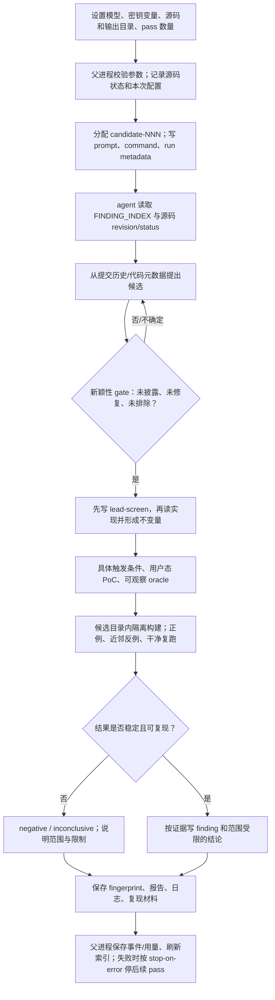

# KScout kernel-vuln：三次监督运行中的 agent workflow

- 日期：2026-10-16
- Linux revision：`24a19b953e2a3d0ea5a8c4951a0ab8f32720c907`（Linux 7.3-rc7）
- 输出目录：`/root/workspace/kscout-workdir`

本文是本次监督运行的独立记录；此前的文档未修改。文中将 KScout 父进程的固定流程、agent 实际留下的操作记录、监督者采取的动作分开描述。`agent-events.jsonl` 能显示 agent 发出的消息和工具调用，但不能还原模型未外显的内部思考，因此以下 workflow 以可观察记录为准。

## 结论

整体结构与此前总结相同：配置一次独立 pass → 选定并筛查候选 → 建立可证伪的不变量 → 做用户态触发器和 oracle → 隔离构建并反复验证 → 按证据给出结论并保存材料。本次观察到的更细节是：**候选新颖性必须作为进入源码分析和实验前的硬 gate；监督者要在 gate 之外再检查 agent 是否遵守排除边界。**

这次没有出现三份完整审计报告：实际启动了三个 child session，但只有 candidate-020 完成；021、022 在进入完整代码审计/实验前被停止。候选方向的选择也没有显示为统一的数值评分或固定排序算法：KScout 提供研究约束和排重索引，具体“选哪条历史/代码路径”仍由 agent 定性决定。可统一的是准入、验证和交付要求，而不是候选打分。

## 可复述的 workflow

### 1. 配置和运行级准备

本次使用 `deepseek-flash`、DeepSeek API base URL、`/root/workspace/linux` 作为只读源码、`/root/workspace/kscout-workdir` 作为输出、`--count 3`、`--show-progress`、`--stop-on-error`。额外 prompt 写明已披露/已修复问题不得作为候选、必须先过 novelty gate，并列出历史审计和本轮遇到的排除范围。密钥通过环境变量传递；日志只保存变量名，不保存值。

KScout 的 CLI 参数定义在 [`kernel_vuln.rs:145`](/root/workspace/kscout/codex-rs/cli/src/kernel_vuln.rs:145)；运行时校验和路径准备见 [`kernel_vuln.rs:288`](/root/workspace/kscout/codex-rs/cli/src/kernel_vuln.rs:288)。自定义 prompt 上限为 8 KiB，见 [`kernel_vuln_support.rs:30`](/root/workspace/kscout/codex-rs/cli/src/kernel_vuln_support.rs:30)。API key 从指定环境变量读取，之后只注入 child 的 `CODEX_API_KEY` 环境变量，见 [`kernel_vuln_support.rs:203`](/root/workspace/kscout/codex-rs/cli/src/kernel_vuln_support.rs:203)。

父进程建立输出目录、刷新 `FINDING_INDEX.md`，写入 run 配置和 Linux 源码的运行前状态，然后为每个 pass 分配第一个可用的 `candidate-NNN`。对应代码：[`kernel_vuln.rs:348`](/root/workspace/kscout/codex-rs/cli/src/kernel_vuln.rs:348)、[`kernel_vuln_support.rs:211`](/root/workspace/kscout/codex-rs/cli/src/kernel_vuln_support.rs:211)。索引由既有候选报告/fingerprint 摘要生成；内置合同明确规定它只用于排除重复根因，不能充当新发现的证据，见 [`kernel_vuln_dedup.rs:11`](/root/workspace/kscout/codex-rs/cli/src/kernel_vuln_dedup.rs:11) 和 [`kernel_vuln.rs:103`](/root/workspace/kscout/codex-rs/cli/src/kernel_vuln.rs:103)。

### 2. 每个 candidate 的准入筛查和选方向

内置合同要求 agent 从源码和提交历史开始，检查索引、避免已修复/已知公开 PoC、先建立不变量、再写 PoC；PoC 必须是普通用户态程序，并有 close control 和干净复跑。要求全文见 [`kernel_vuln.rs:71`](/root/workspace/kscout/codex-rs/cli/src/kernel_vuln.rs:71)。本轮额外 prompt 把“先筛新颖性、遇到已提出/已修复问题即排除、不要围绕已知修复找类似问题”进一步设为硬门槛。

candidate-020 的可见记录显示，agent 先核对 Linux revision/status 和索引，再用提交标题、路径和历史元数据浏览多个子系统；一个带有对应修复提交的 mm 候选在源码深入前被排除。之后它选择 iomap 小型 direct-I/O 路径与 `->iomap_next()` 转换，先写 [`lead-screen.md`](/root/workspace/kscout-workdir/candidates/candidate-020/lead-screen.md) 记录系列、后续历史、测试覆盖、索引排重和 gate 结论，才开始读实现。具体记录见 [`candidate-020/PROCESS_LOG.md`](/root/workspace/kscout-workdir/candidates/candidate-020/PROCESS_LOG.md:11)。

这是**准入流程**，不是统一候选评分器：KScout 没有在这些源码中给候选打风险分或按分数排序；`focus` / `commit` 是可选的用户指定约束，没有指定时 prompt 让 agent 自主选最强候选，见 [`kernel_vuln_support.rs:224`](/root/workspace/kscout/codex-rs/cli/src/kernel_vuln_support.rs:224)。本次能观察到 agent 以定性方式比较历史线索和代码可测性。对外部是否已有公开报告的核查也有局限：agent 所在环境报告无网络，故 candidate-020 的本地 gate 不能证明“全球范围绝无披露”；这一限制在其记录中注明，而不是被当作新颖性证据。

### 3. 从可疑改动变成可证伪假设

通过 gate 后，agent 才把候选转换为明确的不变量、触发前提和用户可观察 oracle。candidate-020 写了两组不变量：

- 小型 direct-I/O 快路径对返回字节、长度/errno、EOF、hole/unwritten extents、page-cache 一致性和异步完成，都应与通用路径一致；
- iomap 迭代模型转换应保留旧 `begin/end` 回调的调用顺序、推进/终止条件、错误传播和 folio-batch 清理。

这些假设及源码路径见 [`candidate-020/candidate-report.md`](/root/workspace/kscout-workdir/candidates/candidate-020/candidate-report.md:15)。随后它把它们落到 ext4 的 O_DIRECT 用户态请求，定义精确返回值/errno、字节比较和异步完成结果为 oracle，并用 kprobe 计数验证请求走了 fast path 还是通用路径。

### 4. 隔离实验、反例和重复验证

内置合同要求 Linux 源码树保持只读，构建、临时镜像、QEMU 和 PoC 产物放在候选目录，并要求成功路径至少两次 fresh setup 复跑和一个 close control，见 [`kernel_vuln.rs:88`](/root/workspace/kscout/codex-rs/cli/src/kernel_vuln.rs:88) 及 [`kernel_vuln_support.rs:292`](/root/workspace/kscout/codex-rs/cli/src/kernel_vuln_support.rs:292)。candidate-020 先解决 initramfs/PoC 自身错误，再跑 72 个确定性 case：两次 fresh setup 的完整运行和最后一次复跑均为 72/72 通过；关闭 fast path 的对照也是 72/72，通过 kprobe 计数确认路径切换。具体实验顺序和无效尝试见 [`candidate-020/PROCESS_LOG.md`](/root/workspace/kscout-workdir/candidates/candidate-020/PROCESS_LOG.md:133)，控制运行原始结果见 [`case-results-run6-control.txt`](/root/workspace/kscout-workdir/candidates/candidate-020/evidence/case-results-run6-control.txt:73)。

此处的判断不是“PoC 运行了就算找到 bug”：若候选没能建立稳定 oracle，合同要求如实给出 negative 或 inconclusive。candidate-020 的最终 fingerprint 因此是 `Outcome: negative`，并列明未覆盖配置和边界，而没有把无异常当成普遍安全证明，见 [`finding-fingerprint.md`](/root/workspace/kscout-workdir/candidates/candidate-020/finding-fingerprint.md)。

### 5. 交付、父进程收尾与停止规则

完整 pass 的候选目录包括 prompt、命令、运行 metadata、`lead-screen.md`、`PROCESS_LOG.md`、报告/fingerprint、用户态 PoC、精确复现步骤、build/guest 日志和证据文件。父进程把 child 的 JSON 事件和 stderr 存为 `agent-events.jsonl` / `agent-stderr.log`，见 [`kernel_vuln_support.rs:330`](/root/workspace/kscout/codex-rs/cli/src/kernel_vuln_support.rs:330)；随后读取 fingerprint 和 token usage，写 candidate `usage.json`、总 `USAGE.jsonl` 并刷新排重索引，见 [`kernel_vuln.rs:586`](/root/workspace/kscout/codex-rs/cli/src/kernel_vuln.rs:586)、[`kernel_vuln_usage.rs:249`](/root/workspace/kscout/codex-rs/cli/src/kernel_vuln_usage.rs:249)。每次 run 结束再保存 Linux 源码状态快照，见 [`kernel_vuln.rs:651`](/root/workspace/kscout/codex-rs/cli/src/kernel_vuln.rs:651)。

本轮观察到 `--stop-on-error` 是批次级停止闸门：child 非零退出后，后续 scheduled candidates 不再启动，见 [`kernel_vuln.rs:619`](/root/workspace/kscout/codex-rs/cli/src/kernel_vuln.rs:619)。这会令“请求 3 次”与“完整完成 3 次”不同，需看 process log，而不能只看命令参数。

## 三个 child session 的实际结果

| Candidate | 实际阶段 | 结果 | 证据 |
|---|---|---|---|
| `candidate-020` | novelty screen → 源码审计 → out-of-tree build → 72-case PoC、复跑和对照 | 完整结束，`negative`；未发现符合合同的确定性漏洞 | [`candidate-020/PROCESS_LOG.md`](/root/workspace/kscout-workdir/candidates/candidate-020/PROCESS_LOG.md)、[`candidate-report.md`](/root/workspace/kscout-workdir/candidates/candidate-020/candidate-report.md)、[`evidence/`](/root/workspace/kscout-workdir/candidates/candidate-020/evidence/) |
| `candidate-021` | `lead-screen.md` 先记录 `O_EMPTYPATH`，再另写 AES library/glue 的第二个候选筛查；后续探索进入被明确排除的 `crypto/af_alg.c` / `af_alg_check_restriction()` | 监督者发 SIGTERM；无 finding outcome、build 或 PoC；第一条 run 的 `--stop-on-error` 阻止后续调度 | [`supervisor-stop-record.md`](/root/workspace/kscout-workdir/candidates/candidate-021/supervisor-stop-record.md)、[`lead-screen.md`](/root/workspace/kscout-workdir/candidates/candidate-021/lead-screen.md)、[`supervisor-public-novelty-screen.md`](/root/workspace/kscout-workdir/candidates/candidate-021/supervisor-public-novelty-screen.md) |
| `candidate-022` | 开始用跨多个子系统的新增文件历史命令做候选生成，之后还查询到明确排除的 `net/unix/af_unix.c` | 监督者发 SIGTERM；尚无 `lead-screen.md`、实现审计、build 或 PoC；补跑的 `--count 2 --stop-on-error` 也因此停止 | [`supervisor-stop-record.md`](/root/workspace/kscout-workdir/candidates/candidate-022/supervisor-stop-record.md)、[`agent-events.jsonl`](/root/workspace/kscout-workdir/candidates/candidate-022/agent-events.jsonl) |

原始批次 `--count 3` 实际结束在 020 完成、021 失败；为补足尝试次数，另启 `--count 2`，但 022 被停止后第二个 scheduled candidate 未启动。因此结论是**三个 session 启动过，一个完整完成**，不是三次完整审计。时间、退出状态和 `stop-on-error` 记录见输出目录 [`PROCESS_LOG.md`](/root/workspace/kscout-workdir/PROCESS_LOG.md:634)。监督者停止原因分别保存在上述两个 `supervisor-stop-record.md` 中。

这些中止也揭示了实际 workflow 的一项限制：prompt 可以把排除范围写成硬规则，但 agent 仍可能越界；因此 novelty gate 在本次既是 agent 自检步骤，也是监督者实际执行的停机条件。被停止的探索只作为流程审计痕迹保存，不作为 finding 或后续候选的发现证据。

## 可用于复述的精简方法

1. 先固定输入、revision、源码状态、输出目录和排除清单；读取索引只为排重。
2. 从当前代码/提交历史提出一个具体候选。先核查同一行为是否已报告、提出、修复或有回归测试；不确定就排除。把这一 gate 和证据写下来，再开实现源码。
3. 写出“什么状态必须保持”以及“哪个用户态操作会违反它”；同时定义能区分正常与异常的确定性 oracle。
4. 用候选目录内的 PoC 和隔离环境检验正例、近邻反例和重复运行；结果不稳定就收窄或否定结论。
5. 交付原始日志、源码位置、准确版本、复现命令、限制和 outcome；由父进程保存事件/用量并按错误策略继续或停止批次。

其中第 2 步是本次监督特别强化的地方。它有明确的 stop/pass 条件，但“先挑哪个候选”的 ranking 仍是 agent 定性选择，不能称为一套统一的候选评分标准。
