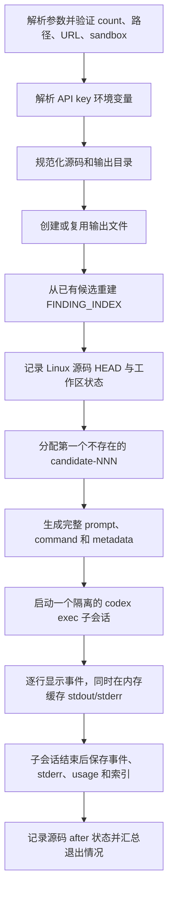

# `kernel-vuln` 工作流程记录

本文记录 `codex kernel-vuln` 的实际编排方式，以及 2026-10-14 在本工作区启动的一次运行。程序本身只负责安排隔离的 Codex 子会话、保存运行证据和汇总退出状态；漏洞审计、PoC 与实验由子会话根据提示词自主执行。提示词提出的研究步骤是工作要求，不是程序能证明已经完成的状态机。

## 本次运行参数与环境

原命令请求在 `/root/workspace/kscout` 运行，使用 Linux 源码 `/root/workspace/linux`、输出目录 `/root/workspace/kscout-workdir`、DeepSeek Responses API、模型 `deepseek-flash`，并关闭 `code_mode_host`。调用时指定了 `--count 1 --show-progress`，没有启用 CVE 规则，也没有提供额外提示词、焦点或 revision。

命令文本中的 `your-deepseek-api-key` 是示例占位符，原样导出会覆盖真实凭据并导致认证失败。本次沿用了进程环境里已存在的 `DEEPSEEK_API_KEY`，只把变量名传给 CLI；凭据值没有打印、写入日志或放进此文档。

用户提供的可执行文件路径 `/root/workspace/codex/codex-rs/target/debug/codex` 在此环境不存在。先尝试该路径后得到 `ENOENT`，随后使用工作区内实际存在的 `/root/workspace/kscout/codex-rs/target/debug/codex`，其余参数相同。实际执行目录为 `/root/workspace/kscout`。复现时可运行：

```sh
cd /root/workspace/kscout
test -n "$DEEPSEEK_API_KEY"
./codex-rs/target/debug/codex kernel-vuln \
  --api-key-env DEEPSEEK_API_KEY \
  --api-base-url https://api.deepseek.com \
  --model deepseek-flash \
  --disable code_mode_host \
  --linux-path /root/workspace/linux \
  --output-dir /root/workspace/kscout-workdir \
  --count 1 \
  --show-progress
```

不要把 `test -n` 替换为打印环境变量的命令。程序从指定环境变量取 key，并仅在子进程环境中映射成 `CODEX_API_KEY`。设置 API base URL 时，CLI 为这个子进程加入临时 provider 配置：provider ID 为 `linux_vuln_provider`、`env_key=CODEX_API_KEY`、`requires_openai_auth=false`。`--disable code_mode_host` 被转换成 `features.code_mode_host=false`。

本次实际子命令记录在 `candidate-005/command.txt`。它调用 `exec --skip-git-repo-check --ephemeral --json`，工作目录是候选目录，给子会话增加 output 根目录和候选目录作为可写目录，使用 `workspace-write` sandbox，并把最后一条回答指定保存至 `agent-final.md`。Linux 树通过提示词作为只读审计目标，不作为可写目录。CLI 启动时输出了 `deepseek-flash` 缺少模型元数据并采用回退元数据的提示，随后会话正常开始；这个提示可能影响性能或行为，不代表请求已失败。

## 编排器的固定阶段

对于本次关闭规则的命令，父进程大致按下图运行：



具体阶段如下：

1. CLI 验证 `count` 在 1 到 100 之间、环境变量名和 API URL 有效，确认 sandbox 能写出证据，并规范化 Linux 与输出路径。源码路径和输出路径不得互为父子目录。
2. 本次未设置 `--use-cve-rules` 或 `--cve-rule`，因此不运行规则扫描器、不生成 `rule-scan-*.md`。`count=1` 调度一个开放式自主审计子会话。它限制子会话数，不限制子会话内部的 API turn、工具调用、耗时或 shell 命令数。
3. 父进程在输出根目录创建 `candidates/`，初始化缺失的 `README.md`、`PROMPT_TEMPLATE.md` 和 `PROCESS_LOG.md`。已存在的文件不会因当前参数而覆盖更新。每次开始运行都会依据既有候选重建 `FINDING_INDEX.md`。
4. 父进程保存 `source-status-before.txt`，内容为 Linux 源码的 Git revision 与工作区状态；这只是前后快照，不会自动比较差异或在源码发生变化时判定失败。
5. 分配候选目录时，从 `candidate-001` 起跳过所有已存在目录。本次已有 001–004，因此分配 `candidate-005`。父进程先写入 `prompt.md`、`command.txt`、`run-metadata.md`，再启动子进程。
6. 子会话从 Linux 源码及其 Git 历史自主选择审计方向。它收到已有 `FINDING_INDEX.md`，只能把历史摘要用于排除重复根因，不能当成发现证据。父程序没有在“读源码、提出假设、写 PoC、运行验证”等步骤间强制编排或验证模型必须按顺序完成。
7. 子会话退出后，父进程从事件中读取最后报告的 usage，读取 `finding-fingerprint.md` 的 outcome（若文件存在），写候选 `usage.json` 并追加顶层 `USAGE.jsonl` 和 `PROCESS_LOG.md`，然后重建 finding index。
8. 父进程写入 `source-status-after.txt` 和本轮汇总。只要子进程退出码为 0，编排器就把该候选记作执行成功；这不表示确认发现漏洞，也不校验模型是否提交了完整 PoC 或控制实验。非零退出或启动/执行错误才会进入父进程失败列表。

内置研究合同见 [kernel_vuln.rs](../codex-rs/cli/src/kernel_vuln.rs#L71)，父进程阶段见同文件的 `run` 函数，子命令、环境变量传递和实时输出见 [kernel_vuln_support.rs](../codex-rs/cli/src/kernel_vuln_support.rs#L257)。

## 子会话收到的研究合同

内置提示词要求一次只研究一个候选，从给定源码和历史开始，不得从目录外已有 PoC 或研究报告搬运发现；不得使用 syzkaller、模糊测试或 corpus mutation。候选需有确定且用户态可观察的 oracle，不接受纯硬件依赖、纯计时问题、不稳定竞争或只有 KASAN 输出的结果。若声称发现，需要提供用户态 PoC、准确复现命令、至少一个相近负对照、干净环境下重复运行、影响与攻击条件评估、源码位置和完整操作记录。不得修改 Linux 源码树；构建与产物放在候选目录。

提示词要求模型写候选报告、`finding-fingerprint.md`、用户态 PoC（可行时包含构建产物）、复现指南、原始命令输出及候选 `PROCESS_LOG.md`。fingerprint 的 outcome 应为 `confirmed`、`plausible`、`negative`、`inconclusive`、`duplicate` 或 `unknown`。这些是给模型的合同；父进程不校验文件齐全性或证据正确性。因此应检查事件日志、候选报告、PoC、控制结果和日志后再评估 finding。

## 实时监督和日志落盘时机

`--show-progress` 会逐行消费子会话 stdout/stderr，并把识别到的 JSONL 事件渲染成 Codex 风格的工具调用和输出。与此同时，父进程把两条原始流缓存在内存中；正常结束后才写入 `agent-events.jsonl` 和 `agent-stderr.log`。因此子会话运行时这些文件尚不存在是正常现象，实时监督应看 CLI 输出或本次外层捕获的控制台日志。

父级 `PROCESS_LOG.md` 主要记录本轮参数、候选启动、结束状态和 usage 汇总，不会实时逐条镜像所有工具调用。更细的审计轨迹由模型生成的候选 `PROCESS_LOG.md` 和原始事件提供。外层监督保存目录为 `supervision/20261014T113143Z/`：

- `console.log`：带 UTC 时间戳的实时终端输出副本。
- `run.json`：实际 binary、参数、PID、执行时间及 exit code；不包含 key 值。
- `before-*`：启动前顶层 `PROCESS_LOG.md`、`FINDING_INDEX.md`、`USAGE.jsonl` 和源码状态快照。

父进程运行细节见 `kernel_vuln_support.rs` 的 `run_agent`、`collect_child_stream`；usage 解析见 `kernel_vuln_usage.rs`。usage 以最后报告的线程累计快照为准，不能把各 turn 累计值直接相加。

## 本次观察到的子会话步骤

截至 2026-10-14 11:37 UTC，子会话仍在运行。实时日志显示它：

1. 读取 Linux HEAD、工作区状态和最近提交；观察到 revision `24a19b953e2a3d0ea5a8c4951a0ab8f32720c907`（Linux 7.3-rc7）。
2. 读取完整的 46 行 finding index，先检查 `candidate-001` 和 `candidate-003` 的既有摘要；后续还通过 shell 浏览 `candidate-*` 目录。
3. 比较 v6.17 到当前 revision 在 fs、mm、kernel、ipc、security、net 等目录的新增文件和提交；枚举期间暂时关注过 `PG_rcu_free` 与 mount-cover 变化。
4. 随后将注意力收敛到新增的 `failfs` 文件系统、`fchroot(FD_FAILFS_ROOT)` 路径及相关 selftest。它读取了 `fs/failfs.c`、`fs/open.c`、`fs/fs_struct.c`、`fs/namespace.c` 以及 `tools/testing/selftests/filesystems/failfs/failfs_test.c`，并浏览了引入 failfs 的提交说明。
5. 它又检查了 `task_exec_state`、dumpability 与 ptrace 权限检查的历史，阅读 `kernel/exec_state.c`、`kernel/ptrace.c`、`fs/exec.c` 和相邻改动，寻找 task 元数据重构后的安全语义变化。
6. 随后转向 Landlock 网络策略，阅读 `security/landlock/net.c`，查看修复 TCP Fast Open 策略绕过的提交，并提出检查 MPTCP 是否也覆盖的假设。它检查了 socket protocol 类型及 `tools/testing/selftests/landlock/net_test.c` 中的 MPTCP 测试变体；这还没有证明 Fast Open 路径被覆盖或存在绕过。
7. 后续又查看 Linux 仓库的 dangling Git 对象、refs 和 worktree 清单。清单显示工作区关联 `/root/workspace/linux-llm-vuln-research/kernel-src` 与 `/tmp/cve-2025-38193-i386/src`。内置合同明确规定这类 output-dir 外研究材料只能排除重复线索，不能作为发现证据或复制 PoC。截至观察时的日志只显示它查看了 Git 管理信息，没有显示读取这些目录的文件内容；应在最终候选审查中再次核对这一点。
8. 它继续检查 `kernel/nstree.c` 中的 namespace tree 与新 `listns()` 遍历/引用逻辑，之后重新阅读工作目录的 README、prompt 和当前候选配置。这是另一条源码审查线索，不代表已确认问题。
9. 之后浏览了 `net/psp`、Landlock 的 `tsync.c`、`rseq_slice_yield()` 和多项历史修复，并查看 Linux Git 元数据中的 `ORIG_HEAD` 与 `FETCH_HEAD`。这说明开放式搜索可反复在 subsystem 和提交线索之间移动；候选选择没有由父编排器限制在固定目录或 CWE 范围。
10. 通过本地 shell 命令进行源码阅读、符号搜索和 Git 历史检查。实时输出里的命令与退出状态保存在 `console.log`；原始完整 JSONL 事件将在子会话结束后落盘。

监督时还发现一条源码清单命令把 `/tmp/newfiles.txt` 写到了候选目录之外，违反了 prompt 对生成文件位置的要求；这不是 Linux 源码改动。另有 `grep | head` 管道在提前关闭输出时记录了 Broken pipe，模型继续执行了后续检查。此类实际行为说明 prompt 合同不能替代对文件写入边界和 shell 退出状态的检查。

候选完整结束时间、模型最终 outcome、是否产出 PoC、对照实验及父进程退出码应在运行结束后补记。不要把模型的 `turn.completed`、CLI 的 `candidate finished successfully` 或父进程 exit 0 单独当作漏洞确认。

运行日志随后将 `origin/noref-filemap-read-with-llm` 称为当前树中最强的线索，指出这是镜像中 LLM 生成的未合并提交系列，并开始审阅整个差异以寻找区别于 candidate-003 的问题。该分支属于源码仓库 refs，也可视为提示词允许的提交历史审计单元；模型已显式识别其生成来源，是否把既有研究材料作为发现起点仍需结合完整事件与最终报告审查。它重点阅读了 `mm/filemap.c`、`mm/page_alloc.c` 和 `PG_rcu_free` 改动；截至此处，没有复现或确认结果。

之后它枚举 `i_pages` 的 xarray 写入和 page-cache 移除入口，试图找出漏掉延迟释放标记的路径，开始检查删除/迁移/替换实现覆盖是否完整。这表明实际子会话能在读 patch 后自行设计源码覆盖性检查；父进程只显示和留存这段工作，不判断检查是否充分。运行中还出现了 Codex 关于长线程可能降低准确性的提示。

完整性核对把标记调用与所有 xarray store 分别列出，再定向查看 `mm/truncate.c`、`mm/khugepaged.c`、`mm/migrate.c`、`mm/shmem.c` 中未标记的替换/清除位置，以判断它们操作的是 folio 还是 swap/其他条目。一次复合 shell 搜索因 zsh 转义错误返回 `zsh:1: == not found`；模型查看到命令失败后改用 `git show` 直接读目标源码继续检查。

模型还把该分支提交的 348 行 cover letter 保存到候选目录的 `evidence/series-cover-letter.txt`。信中有作者的 “Known problems, and what I'd like eyes on” 清单；模型接着查看清单并表示要核对 `filemap_read` 是否由非用户态 iterator 调用。该检查方向已经出现在源分支的研究说明中，最终报告若涉及这些问题须明确作为已知风险复核，并提供独立代码论证与复现证据，不能仅凭 cover letter 宣称新发现。

收到长线程提示后，子会话从 checkpoint 继续，重新检查候选目录、Linux revision 和源码状态，并查看磁盘/内存余量。它报告约 21 GiB 可用内存、swap 几乎用满，因而说若编译会限制并行度；截至当前观察，尚未启动内核构建或 PoC 实验。

随后它检查本机 GCC、QEMU、`.config` 和 `/dev/kvm`，发现没有 `/dev/kvm`。它提出在后台构建分支内核，但创建隔离源码副本时使用了 `rm -rf src-branch`，子工具安全策略拒绝了该命令；这次拒绝没有执行删除或 clone。它改为在候选目录保存完整 795 行分支差异 `evidence/series.diff`，继续逐个审阅 patch。模型短暂提出 `folio_batch_add()` 满批处理可能丢 folio 的假设，并检查 helper 语义；随后转向 `listns()` 权限与 namespace 引用计数，核对 `kernel/nstree.c`、`kernel/nscommon.c`、`fs/nsfs.c`、近期权限修复提交和已有 listns selftests。至当前记录，仍没有内核构建、PoC 或运行时复现结果。

后续模型又回头复核 Landlock TCP Fast Open/MPTCP 线索，搜索了协议判断、修复提交和现有测试矩阵，确认 selftest 已覆盖 IPv4/IPv6 的 MPTCP 变体；这条线索仍未形成缺陷结论。它也继续读取 page-cache patch 和 xarray 实现，且有若干 shell 查询因引号/转义错误失败后改写命令重试。

长线程再次恢复时，它重读了 `FINDING_INDEX.md`：其中 `candidate-003` 已标为 `confirmed`，根因同样涉及 `PG_rcu_free`、`vmsplice(SPLICE_F_GIFT)` 与 FUSE。当前模型此前表示要找不同于该问题的独立问题；最终是否遵守去重合同，应以 candidate-005 的 fingerprint 和报告为准。

之后模型又核对了源码状态、候选目录与内存读数，从 page-cache/namespace 路径转去 `nullfs` 可达性。该范围与 `candidate-001` 已记录的 mount-cover/nullfs 审计重叠；父编排器不会阻止同一候选反复切换到已审过的子系统，是否属于重复仍由最终 fingerprint 和报告决定。它查看了 worktree/ref 元数据，但本次日志尚未显示读取外部 worktree 中的研究文件。

nullfs 的 `mmap` 假设被 `can_mmap_file()` 对缺失 mmap hook 的拒绝路径排除后，模型检查了 `file_getattr()` 空路径、新增的 NTFS WOF 解压器以及 `delayed_getname()` 的引入和调用场景。它仍以源码和提交历史审查为主，没有启动测试或 PoC。

后续它又把 `PG_rcu_free` 分支与当前源码中的 xarray 清除、truncate、迁移、shmem、khugepaged 路径逐项比对；读取已有 candidate-003 结果后继续寻找不同根因。除先前的 `/tmp/newfiles.txt` 外，日志还显示它将 `khugepaged.c` 临时复制到 `/tmp/branch_khugepaged.c`，这违反 prompt 对生成文件应保存在候选目录的要求；两项都不是 Linux 源码修改。

静态审阅后，模型决定测试该系列的资源耗尽假设：RCU 延迟释放的页在等待期内不回到 allocator，可能导致额外内存压力/OOM。它准备在 candidate-005 建立基线、patch 6、series tip 三份源码快照，并进行基线对照。第一次 `git archive | tar` 因目标目录尚未创建而失败；随后先创建 `trees/base-src`、`trees/p6-src`、`trees/tip-src` 并重试。这些测试快照与后续 build/PoC 文件都计划放在候选目录内；实验结果尚待补记。

三份快照均通过 `defconfig`，随后各自用 `make -j40 bzImage` 并行构建。三份 x86 内核镜像都生成成功。模型在 `poc/lab.c` 编写内存压力 harness，并用 `gcc -O2 -static` 编译成功。因本机没有 `/dev/kvm`，它计划继续确认 QEMU 能否用 TCG 运行这些镜像；是否实际跑通仍待结果。

它已用 QEMU TCG 在 2 GiB、4 vCPU 配置启动基线内核，运行 512 MiB file-backed hole-punch 的三轮 observe。第一次 harness 输出未正确解析 `/proc` 数值和 cmdline 参数；模型修正 `lab.c` 后重编译重跑。修正版日志记录到内存先下降后恢复，基线 `pgfree_rcu` 指标始终为 0，运行约 23 秒后关机。

为了观察释放延迟，它给 harness 增加每 5 ms 采样的 `watch` 模式，并在 patch-6 内核上单次 punch 512 MiB。日志显示约 131k 页进入 `pgfree_rcu`，初始采样时约 2.6k 页尚未计入 done；约 12 ms 后第一次采样时 done 已追平。单次小压力没有显示长期内存缺口；模型接下来计划增大并发并比较 tip。

并发压力的初始配置（4 hammer × 64 MiB、1.4 GiB 匿名页、4 轮）在 patch 6 上完成且 `oom_kill delta=0`。调到 8 vCPU、8 hammer × 32 MiB、1.7 GiB 匿名页、3 轮后，patch-6 QEMU 日志出现一次 OOM，内核向 `big` 工作进程发送 SIGKILL（`oom_kill delta=1`）。模型正在运行完全相同参数的基线对照，之后还需在 tip 上验证；这个单一现象本身不能说明根因或安全影响。

8×32 MiB 配置下基线同样 OOM；模型认为 hammer 持有的 tmpfs 页在无 swap 环境中不可回收，于是将 hammer footprint 降至 8×8 MiB、匿名压力提高到 1.75 GiB。此时 patch 6 OOM 增量为 1，基线完成三轮且 OOM 增量为 0，初步得到可区分的对照。

模型随后 grep 到这个 allocator 可见性/OOM 现象已明确列在 `series-cover-letter.txt` 的 “Known problems, and what I'd like eyes on” 中，cover letter 还给出相关 VM 压力数据。因此即使复现成功，也属于既有研究风险的验证，不能作为本轮新发现。series tip 对照仍待执行，以判断后续 expedite patch 是否缓解该已知问题。

随后它完成了基线、patch-6 与 series tip 三份源码快照的 `x86_64_defconfig` 和 `bzImage` 构建；配置一致。因无 `/dev/kvm`，运行环境使用 QEMU TCG。原始 2 GiB / 16 vCPU 压力参数下，tip 的 5 次运行全部触发 OOM；基线 3 次中 2 次完成、1 次在内存边界触发 OOM；patch-6 的 1 次运行触发 OOM。另在 8 vCPU、相同的 8×8 MiB churn 配置下，patch-6 4 次中 2 次 OOM，基线 3 次均完成，tip 1 次完成。模型随后降低压力参数并增加连续采样，发现低 MemAvailable 与 OOM 的发生位置受释放批次和监视器输出节奏影响，所以没有把单次固定负载 OOM 当成独立结论。

为把因果前提放进 PoC，子会话增加了 `lab.mode=trigger`：worker 先读取 `/proc/vmstat` 中 `pgfree_rcu - pgfree_rcu_done`，达到 256 MiB 后才开始按 8 MiB 块触碰匿名内存；如果超时仍未达到阈值，就走基线控制路径并执行相同分配。第一轮 tip（`gate=30`）在门槛达到前超时，之后 OOM，但不算门控成功。随后的两次 tip（`gate=20`）分别在 hidden=284 MiB、335 MiB 时开门并 OOM；两次基线（`gate=30`、`gate=20`）始终 hidden=0，均完成 1600 MiB 分配。门控 tip 的最后一次 worker 采样和 monitor 峰值仍不同，分别记录在候选原始日志中；应将“进入门槛后 OOM”与“精确失败瞬间仍有多少页未完成”分开理解。

KScout 最终为 `candidate-005` 写入 `Outcome: confirmed`，报告将其限定为未合并 series 的 allocator 可见性/可用性缺陷，并指出根因及 patch-6 OOM 已由 series 作者在 cover letter 的 Known problems 中披露；这不是对上游 HEAD 的发现。父进程只读取模型写下的 outcome，并不会独立校验它。Linux 树运行前后均为 HEAD `24a19b953e2a3d0ea5a8c4951a0ab8f32720c907` 且工作区 clean。详细子报告、PoC、实验日志和父级监督日志分别位于 `/root/workspace/kscout-workdir/candidates/candidate-005/` 与 `/root/workspace/kscout-workdir/supervision/20261014T113143Z/`。

父级记录的本轮启动/结束时间为 2026-10-14 11:31:45–13:41:11 UTC，约 2 小时 9 分；子会话 usage 最后一条累计快照报告输入 64,576,007 tokens、输出 982,034 tokens，父级将该快照写入候选 usage 和顶层汇总。该数字是模型 provider 的 usage 报告，不是本地测量的计费值。

该组对照曾把基线 QEMU 放在后台、同时前台运行 patch-6 VM；Codex 工具命令返回后后台 VM 随会话终止，没有留下完整结果。模型确认无残留 QEMU 进程后改为前台重跑基线。这一轮 shell/VM 生命周期问题也记录在原始 console log。

## 输出文件及其来源

| 路径 | 生成者和时机 | 用途 |
| --- | --- | --- |
| `PROCESS_LOG.md` | 父进程初始化并追加本轮/候选摘要 | 编排时间线、失败状态和 usage 汇总 |
| `FINDING_INDEX.md` | 父进程每轮开始及子会话结束后重建 | 给后续模型任务排除重复候选 |
| `source-status-before.txt`、`source-status-after.txt` | 父进程每轮覆盖写入 | 记录源码 revision 和状态快照 |
| `USAGE.jsonl` | 父进程每个已运行候选结束后追加一行 | 跨候选 usage 汇总 |
| `candidate-NNN/prompt.md` | 父进程启动前写入 | 该轮完整系统研究合同与运行路径 |
| `candidate-NNN/command.txt` | 父进程启动前写入 | 子进程命令行；API key 值不在 argv 中 |
| `candidate-NNN/run-metadata.md` | 父进程启动前写入，结束后追加 usage 摘要 | 模型、sandbox、规则模式和日志位置 |
| `candidate-NNN/agent-events.jsonl`、`agent-stderr.log` | 父进程在子进程结束后写入 | 原始事件流和 stderr |
| `candidate-NNN/agent-final.md` | Codex 子进程按 `--output-last-message` 写入 | 子会话最终回答 |
| `candidate-NNN/finding-fingerprint.md`、报告、PoC、验证日志 | 子会话按 prompt 合同产出 | 候选论证与复现证据；父级不保证或验证完整性 |
| `candidate-NNN/usage.json` | 父进程在子进程结束后写入 | 该候选的退出信息、耗时和可用 token 统计 |

本次完整目录在 `/root/workspace/kscout-workdir/candidates/candidate-005/`。程序不会覆盖旧 `candidate-NNN`；同一 output 目录下的序号会继续增长。

## 如何解读运行结果

应分别看 `child_result`、`exit_code` 和 `finding_outcome`。前两项描述子会话是否正常结束；`finding_outcome` 是模型写入 fingerprint 后由父程序读取的标签。退出成功可以对应 `negative` 或 `inconclusive`，也可能没有 fingerprint。`confirmed` 仍需人工依据 PoC、正向复现、负对照、日志和现实影响分析来审查。

规则扫描是独立可选模式，本次没有执行。启用 `--use-cve-rules` 或 `--cve-rule` 后，CLI 扫描选定 CVE 规则的源码范围，生成 `rule-scan-*.md`，然后按规则家族分组审查；扫描命中只是候选线索，不是漏洞结论。详见 [kernel-vuln-hunt.md](kernel-vuln-hunt.md) 与 [kernel-cve-rule-knowledge.md](kernel-cve-rule-knowledge.md)。
