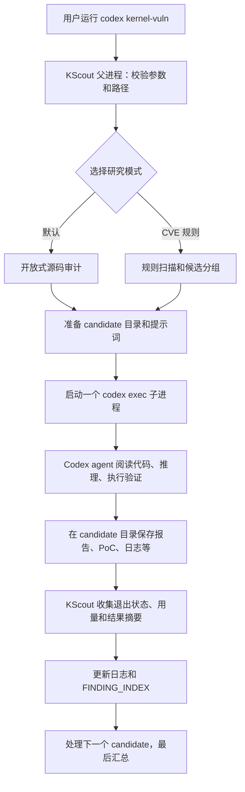
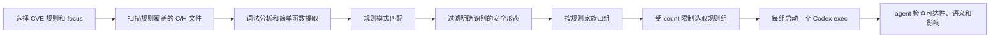

# KScout Harness 与工作流程说明

这份文档按代码实际做的事解释 KScout：它怎样启动 Codex、怎样组织 Linux 内核漏洞研究、哪些步骤由程序保证、哪些步骤只是交给模型执行。

## 先记住这句话

**KScout 是加在 Codex CLI 上的一层研究调度器（harness）。**它负责准备输入和工作目录、启动 Codex 子进程、收集日志和整理结果；真正阅读内核代码、推理漏洞、写 PoC 的 agent 工作，仍由 Codex 的执行引擎和模型完成。

可以把它想成一个实验室：

| KScout 里的东西 | 可以怎么理解 |
| --- | --- |
| `kernel-vuln` 父命令 | 实验室调度员，按固定流程准备和收尾 |
| 一次 `codex exec` 子进程 | 一个独立研究员 |
| `candidate-NNN/` | 这个研究员自己的记录本和工作台 |
| 提示词中的研究约定 | 任务说明和交付要求 |
| 可选 CVE 规则扫描器 | 帮忙缩小检查范围的筛网，不是漏洞判定器 |
| `FINDING_INDEX.md` | 以前报告的摘要，用于避免重复提交同一根因 |

## 从哪里进入

KScout 在 Codex CLI 中新增了 `kernel-vuln` 子命令，也提供 `vuln-hunt` 这个别名。入口注册在 [`main.rs`](codex-rs/cli/src/main.rs)；实际调度主要在 [`kernel_vuln.rs`](codex-rs/cli/src/kernel_vuln.rs)。

KScout 没有在父进程里重新实现一套模型循环。父命令会用当前正在运行的 Codex 可执行文件，再启动一个非交互式 `codex exec` 子进程。这样子进程继续使用 Codex 已有的模型配置、认证、工具、沙箱和事件流能力。

可以把整体结构简化成这样：



## 两种研究模式

### 1. 默认模式：开放式审计

默认不启用 CVE 规则。每个 candidate 都会收到开放式内核漏洞研究提示词，让 agent 从给定源码和历史中自主找线索、分析并验证。

`--count N` 表示最多安排 N 次独立研究 pass。每次 pass 启动一个新的 Codex 子进程，并使用单独的 `candidate-NNN/` 目录。父进程按顺序运行这些子进程，不是同时并发启动 N 个 agent。每轮结束后会刷新发现索引，后续轮次可以看到已有摘要。

这不等于每轮一定会发现一个不同的漏洞：提示词要求 agent 检查重复项，但父进程没有对模型的研究过程做强制去重，也不能保证每轮都得到有效结果。

### 2. CVE 规则模式：先扫描，再定向复核

使用 `--use-cve-rules` 或一个/多个 `--cve-rule CVE-ID` 后，会进入规则模式。可用 `--focus` 缩小到规则声明的子系统或目录范围。

当前实现中的规则是人工整理的 CVE 派生规则。扫描器只在规则声明的源码范围内读取 C/H 文件，用一个有边界的词法器和简单函数提取逻辑匹配模式，并应用已知安全形态过滤。然后它把命中位置按规则家族归组，再交给 Codex 做语义复核。



规则扫描器是**候选筛选器**，不是漏洞证明器。它不是完整 C 编译器：不能完整理解宏展开、预处理条件、类型系统和所有控制流。因此：

- 扫描命中只表示值得复核，不代表已确认漏洞。
- 没有命中也不表示代码安全。
- 扫描报告会保留解析失败等覆盖缺口。
- 如果规则模式没有产生可复核的规则组，就不会为了凑数再进行开放式搜索。
- 规则模式下的 `--count` 限制的是要复核的**规则组数量**，不是源码命中数量。

规则和实现可以从 [`kernel_vuln_rules.rs`](codex-rs/cli/src/kernel_vuln_rules.rs)、[`kernel_vuln_rule_prompt.rs`](codex-rs/cli/src/kernel_vuln_rule_prompt.rs) 以及 [`kernel_vuln_rule_report.rs`](codex-rs/cli/src/kernel_vuln_rule_report.rs) 开始读。知识材料和规则维护方式见 [`kernel-cve-rule-knowledge.md`](docs/kernel-cve-rule-knowledge.md)。

## 一次运行具体经过什么

下面是父进程能确定执行的部分。对应主流程在 [`kernel_vuln.rs`](codex-rs/cli/src/kernel_vuln.rs)，子进程参数、提示词和日志处理在 [`kernel_vuln_support.rs`](codex-rs/cli/src/kernel_vuln_support.rs)。

### 第一步：检查参数和实验目录

KScout 检查 `--count` 范围、额外提示词、API 配置、focus 和沙箱选项，并规范化 Linux 源码目录和输出目录。它拒绝源码目录与输出目录重叠，避免把实验产物写进内核源码树。

默认值包括：

- Linux 源码：`/root/workspace/linux`
- 输出目录：`./linux-vuln-set`
- API key 环境变量：`OPENAI_API_KEY`
- 默认沙箱：`workspace-write`

`--extra-prompt` 或 `--extra-prompt-file` 可以补充任务要求；两者不能同时指定。额外提示有大小和文本格式限制。额外提示会追加到任务中，但不能取消基础研究约定。

### 第二步：可选地运行 CVE 规则扫描

只有规则模式会扫描源码并生成 `rule-scan-<时间>.md` 报告。开放式模式跳过这一步，直接安排研究 pass。

### 第三步：准备输出目录和源码快照

KScout 创建 `candidates/`，记录源码的 Git revision 和工作区状态，并准备根目录中的 README、提示词副本和过程日志。它会在运行开始时重建 `FINDING_INDEX.md`。

已存在的 candidate 目录不会被覆盖。新任务会使用下一个空闲编号，例如 `candidate-001/`、`candidate-002/`。

### 第四步：为每个 candidate 固化任务

在启动 agent 前，父进程把实际提示词、子进程命令和运行参数摘要写入 candidate 目录。这样可以追查 agent 当时收到了什么任务、使用了什么主要配置。

在开放式模式下，提示词来自 [`kernel_vuln.rs`](codex-rs/cli/src/kernel_vuln.rs) 的 `PROMPT_TEMPLATE`。它要求 agent 做可重复、用户态可触发的验证，写清楚根因、影响、正反控制和证据，并在证据不足时报告 negative 或 inconclusive。

在 CVE 规则模式下，KScout 用规则专属提示词，向 agent 提供选中的规则知识和源码命中位置，让它判断代码语义和漏洞条件是否真的成立。

### 第五步：启动 Codex 子进程

命令构造位于 [`kernel_vuln_support.rs`](codex-rs/cli/src/kernel_vuln_support.rs) 的 `build_child_args`。它大体使用这些 Codex `exec` 能力：

- `--cd <candidate-dir>`：把 candidate 目录设为子进程工作目录。
- `--add-dir <output-dir>` 和 `--add-dir <candidate-dir>`：允许 agent 在实验输出范围内写证据。
- `--json`：让父进程接收机器可读的事件流。
- `--ephemeral`：不把这次 exec 当成普通持久化交互会话保存。
- `--output-last-message <candidate>/agent-final.md`：保存 agent 最后的回复。
- 从标准输入 `-` 读取完整任务提示词。

父进程把 API key 放在子进程环境变量中，不把 key 写进命令行或运行日志。如果指定兼容 Responses API 的 base URL，它会通过临时配置覆盖传给子进程。

默认沙箱是 `workspace-write`，让 agent 可以把证据写到输出目录，同时不把 Linux 源码目录加入可写目录。`--dangerously-bypass-approvals-and-sandbox` 会关闭审批和沙箱，代码注释建议只在隔离研究虚拟机中使用。

### 第六步：agent 自己完成研究

这一步是模型和 Codex agent 的工作：读取源码、查历史、提出假设、写 userland PoC、运行验证、观察日志并形成结论。父进程会转发进度（启用 `--show-progress` 时），但不会逐项接管模型的推理，也不会用状态机强迫它按每个研究步骤依次完成。

基础提示词写明了期望，例如不能用 fuzzing，不能修改 Linux 源码，不能把已公开或已修复的漏洞冒充新发现；要验证正向触发、接近的负向控制和干净重跑，并保留命令和原始输出。这些是**模型收到的任务约定**，不代表父进程已自动证明这些动作都发生过。

### 第七步：收集结果并准备下一轮

子进程退出后，KScout 保存 JSONL 事件流和 stderr，读取 token 用量，并尝试从 `finding-fingerprint.md` 读取 `Outcome`。随后它更新 candidate 用量记录、根目录 `USAGE.jsonl`、`PROCESS_LOG.md` 和 `FINDING_INDEX.md`。若设置了 `--stop-on-error`，子进程失败后就不再启动后续 pass。

最后它再记一次源码状态，并输出运行摘要。父进程的成功/失败状态主要反映子进程是否正常完成；这**不等于漏洞已经被确认**。

## 提示词、规则和程序代码分别负责什么

理解 KScout 的关键是把“硬流程”和“研究判断”分开：

| 内容 | 谁负责 | 能保证什么 |
| --- | --- | --- |
| 参数校验、目录隔离、编号分配、进程启动 | KScout Rust 父进程 | 这些程序步骤按代码逻辑运行 |
| 运行的提示词和规则内容 | KScout 生成并传给子进程 | 子进程收到明确任务和约束 |
| 读代码、判断漏洞、验证 PoC | Codex agent 和模型 | 只能要求和引导，结果仍需审查 |
| 源码快照、输出日志和用量记录 | KScout 父进程及 Codex exec | 帮助复查过程，不自动证明结论正确 |
| CVE 模式下的词法匹配 | KScout 规则扫描器 | 找出符合代码模式的复核候选，不判断可利用性 |

因此 KScout 的 harness 不是一套会自行理解漏洞的 Rust 分析器，也不是对模型结论的形式化证明系统。它把研究任务拆成可重复运行、按 candidate 留档的 Codex 工作单元。

### 和 `.codex/skills` 的关系

KScout 的基础研究约定是 Rust 代码中的 `PROMPT_TEMPLATE`。每次运行时，父进程把它渲染成该 candidate 的完整提示词，通过标准输入交给 `codex exec`；因此这份任务说明是 KScout 工作流明确传入的内容。

`.codex/skills` 则是 Codex 自己的可复用技能指令。它不是 KScout 的调度代码，也不会替 KScout 创建 candidate、启动子进程或整理日志。子进程仍可能按 Codex 自己的规则使用可见的 skills 或其他项目指令；KScout 的 Rust 父进程本身没有把 `PROMPT_TEMPLATE` 安装成 skill，也没有在每次运行时显式选择某个 skill。

简单说：基础提示词负责“这次任务必须做什么”，skill 适合补充“某类任务通常怎样做”。两者可以同时影响子 agent；关键研究约束放在 KScout 固定提示词里会随每轮任务明确发送，而依赖某个 skill 时，还要确认该 skill 对子进程可见并确实适用于当前任务。

## 输出目录里有什么

一次运行可能生成如下结构（具体文件取决于运行模式和 agent 实际交付）：

```text
linux-vuln-set/
├── README.md                    # 输出目录说明；若已存在则不覆盖
├── PROMPT_TEMPLATE.md           # 提示词副本；若已存在则不覆盖
├── PROCESS_LOG.md               # 各轮运行摘要
├── FINDING_INDEX.md             # 从已有结果重建的发现索引
├── USAGE.jsonl                  # 每个 candidate 的模型用量记录
├── source-status-before.txt     # 运行开始时的源码 revision/status
├── source-status-after.txt      # 运行结束时的源码 revision/status
├── rule-scan-<时间>.md           # 仅规则模式生成
└── candidates/
    └── candidate-001/
        ├── prompt.md             # 实际发送的任务提示词
        ├── command.txt           # 子进程命令（不含 API key 值）
        ├── run-metadata.md        # 本轮参数摘要
        ├── agent-final.md        # agent 最后的回复
        ├── agent-events.jsonl    # Codex 事件流
        ├── agent-stderr.log      # 子进程 stderr
        ├── usage.json            # 本轮 token 用量摘要
        ├── finding-fingerprint.md # agent 尝试给出的结论指纹
        ├── report.md             # agent 可能生成的漏洞报告
        ├── poc.*                 # agent 可能生成的 PoC
        └── ...                   # 复现步骤、过程日志、原始输出等
```

根目录的若干说明文件采用“只在不存在时创建”的方式，因此如果重复使用同一输出目录，`PROMPT_TEMPLATE.md` 可能是旧版本；每轮的 `candidate-NNN/prompt.md` 才是该轮实际使用提示词的记录。`FINDING_INDEX.md` 则会从当前输出目录中可用的结果摘要重建。

详细的流程说明也见 [`kernel-vuln-workflow.md`](docs/kernel-vuln-workflow.md) 和 [`kernel-vuln-hunt.md`](docs/kernel-vuln-hunt.md)。

## 怎么读结果，哪些结论不能直接照单全收

### `Outcome: confirmed` 仍然是待审结论

`finding-fingerprint.md` 是 agent 写的文本文件。KScout 会读取其中的 outcome 用于日志或索引，但不会独立证明漏洞成立，也不会检查 PoC 是否真的符合所有约定。`confirmed` 是 agent 给出的状态，不是 KScout 的认证徽章。

复核时至少应检查：

1. 报告是否给出可定位的源码位置和完整根因链。
2. 触发条件是否现实、是否由普通用户态程序触发。
3. 正向 PoC 是否产生了明确且可重复的 oracle。
4. 负向控制是否真的隔离了关键触发条件。
5. 原始命令、内核/用户态日志和 revision 是否支持报告结论。
6. 是否已在当前源码修复，是否与已有 finding 属于同一根因。
7. 影响和攻击前提是否有证据支撑，而非推测。

### `FINDING_INDEX.md` 只是去重提示

索引由已有 candidate 的 fingerprint 或报告摘要构建，并提供给后续任务作为排除重复根因的参考。它不是自动判重数据库，也不会阻止 agent 再次提出类似结论。索引内容不能替代对源码和证据的审查。

### 源码状态快照不是防篡改证明

运行前后记录 Git revision/status 有助于检查源代码是否变化，但它不是完整的审计或防篡改机制。默认沙箱会限制写入范围，提示词也要求不改源码；如果启用了危险的沙箱绕过，就应更仔细核对源码状态和实验环境。

## 常用运行方式

开放式审计：

```bash
codex kernel-vuln \
  --linux-path /path/to/linux \
  --output-dir ./linux-vuln-set \
  --count 2 \
  --show-progress
```

在 CVE 规则模式下按范围扫描：

```bash
codex kernel-vuln \
  --linux-path /path/to/linux \
  --output-dir ./linux-vuln-set \
  --use-cve-rules \
  --focus fs \
  --count 3
```

只选择指定 CVE 派生规则时，把 `CVE-ID` 换成仓库中已有的规则 ID：

```bash
codex kernel-vuln --cve-rule CVE-ID
```

`--dry-run` 可以生成提示词、命令和参数记录但不联系模型，适合先检查运行会准备什么。

## 代码阅读路线

如果要自己沿着实现读，建议按这个顺序：

1. [`main.rs`](codex-rs/cli/src/main.rs)：看 `kernel-vuln` 子命令怎样注册和分发。
2. [`kernel_vuln.rs`](codex-rs/cli/src/kernel_vuln.rs)：看参数、模式选择和父进程主循环。
3. [`kernel_vuln_support.rs`](codex-rs/cli/src/kernel_vuln_support.rs)：看提示词渲染、子进程参数、进程运行和文件写入。
4. [`kernel_vuln_rules.rs`](codex-rs/cli/src/kernel_vuln_rules.rs)：看 CVE 模式怎样扫描和筛选候选。
5. [`kernel_vuln_rule_prompt.rs`](codex-rs/cli/src/kernel_vuln_rule_prompt.rs)：看规则复核任务怎样交给 agent。
6. [`kernel_vuln_dedup.rs`](codex-rs/cli/src/kernel_vuln_dedup.rs) 和 [`kernel_vuln_usage.rs`](codex-rs/cli/src/kernel_vuln_usage.rs)：看发现索引和 token 用量怎样整理。

总的来说，KScout 把 Codex 的一次次 agent 执行包装成有参数、有隔离目录、有过程记录、有结果索引的漏洞研究流程。它擅长的是**调度和留档**；漏洞是否真实、是否可利用、影响有多大，仍然要看源码证据和可重复实验。
